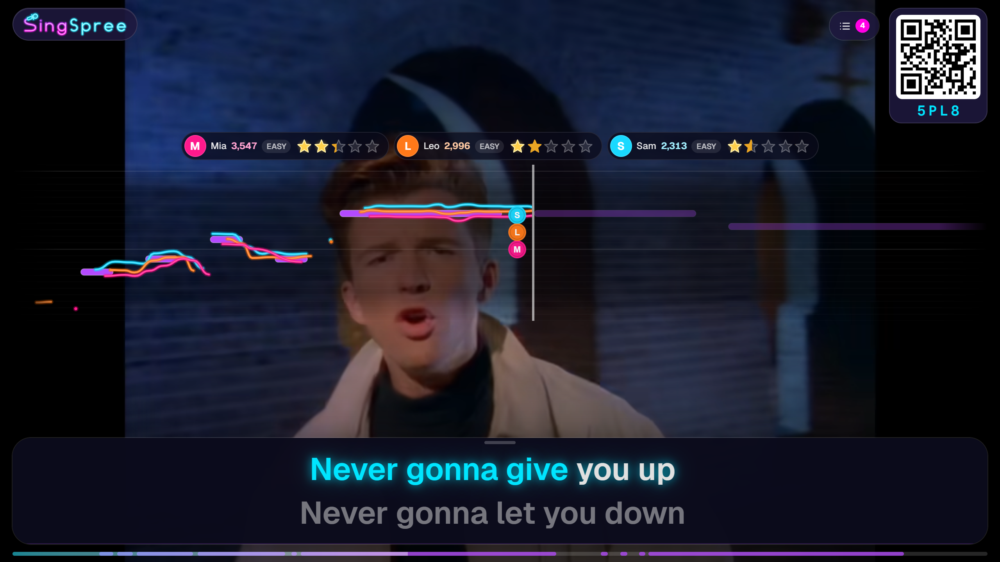
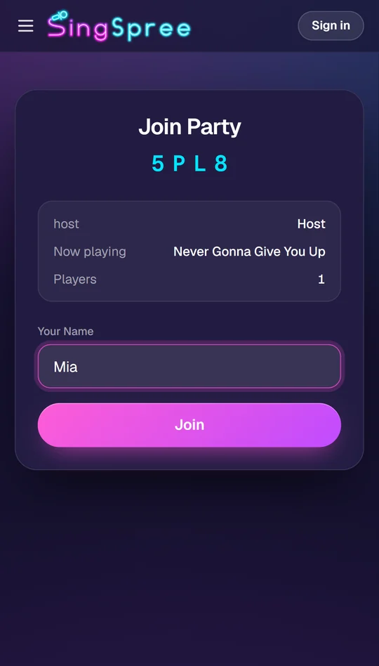
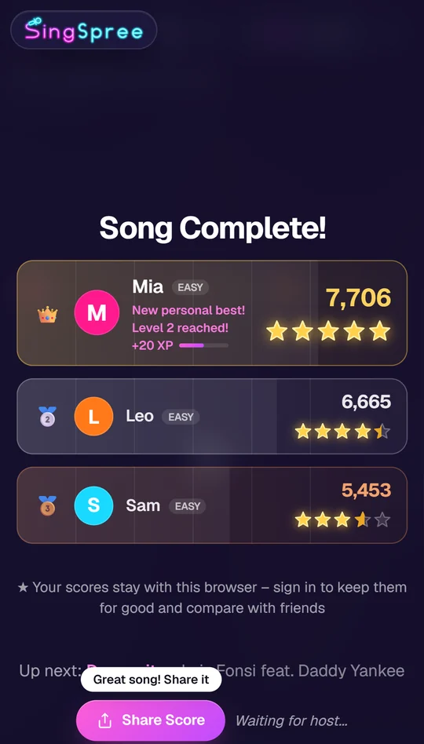
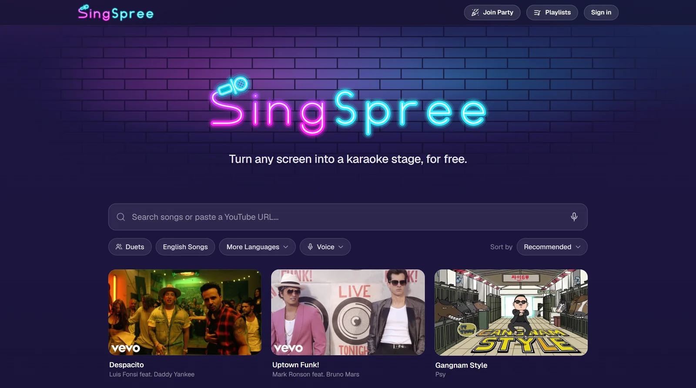
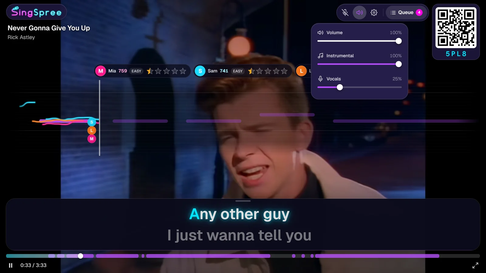
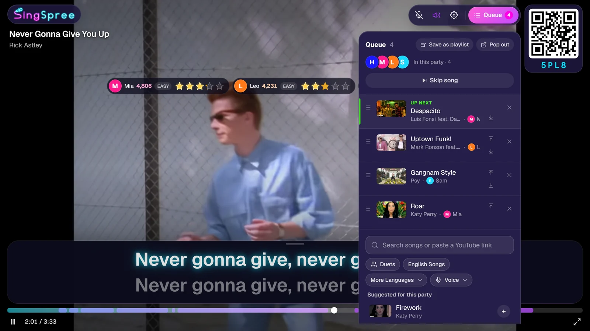
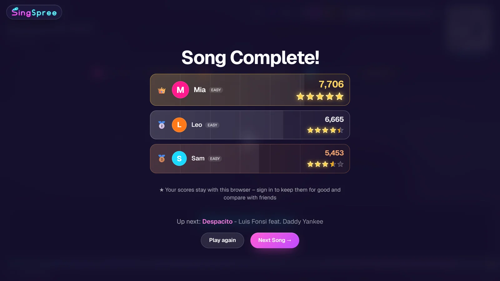

# SingSpree

**Free online karaoke with friends.** Sing on whatever screen you have, from a TV to just your phone, and see who hits the notes.

**[▶ Start singing at singspree.com](https://singspree.com)**



## How it works

1. **Open [singspree.com](https://singspree.com)** on any device (a phone, tablet, laptop or TV) and pick a song.
2. **Sing right there, or bring friends in:** they scan the QR code with their phones (no app, no account) and each phone becomes a microphone.
3. **Sing!** Every voice shows up on screen as a line in its own color, scored note by note.

<p align="center">
  
  &nbsp;&nbsp;
  
</p>

## Features

### 30,000+ songs
Pop, rock, Schlager, K-pop and more in over 20 languages, each with synced lyrics and the melody to sing. Search by title or artist, filter for duets or a language, or let SingSpree listen to music playing in the room: it finds the song and starts right where it was.



### Turn the singer down
For most songs the original vocals are separated from the music. Slide the singer down and sing over the band yourself, or leave a little in as a guide.



### Everyone adds songs
Anyone in the party can queue songs from their phone. Reorder them, see who picked what, get suggestions that fit the party, and save the night's queue as a playlist for next time.



### Scores, stars and a winner
Your pitch is drawn as you sing, right over the notes you should hit. Points and stars fill up live, the score screen crowns the winner, and you level up as you sing. Everyone picks their own difficulty, from very easy to very hard.



### And more
- **Any song from YouTube** (beta): paste a link and AI times the lyrics and melody for it in a minute or two. Needs a free account.
- **Duets** with a part for each singer.
- **Hear yourselves**: phones can send their singer's voice to the host's speakers.
- **Slow a song down** to learn it, or speed it up, without changing the key.
- **Tap a lyric line** to jump there.
- **Co-hosts** run the music from their own phones.
- **Big parties**: up to eight singers on screen at once; with more, they take turns line by line.
- **Share your score** as a card, or as a short video of your best moment.
- **On the TV too**: works with a TV remote, and there's a [Fire TV app](https://singspree.com/firetv). An [Android app](https://singspree.com/android) is in testing.
- **A free account, if you like**, keeps your scores and recordings for good, with a profile picture and your best songs.

<details>
<summary><b>Tech stack</b></summary>

- **React 19** and React Router 7, written in **TypeScript 7** (strict)
- **Vite 8** for the dev server and build, **Tailwind CSS 4** for styling (no component library)
- **Pitch detection in the browser**: an AudioWorklet feeds the swift-f0 model, which runs in a worker on our own minimal build of ONNX Runtime 1.31 for WebAssembly
- **The note highway** is painted in a worker on an OffscreenCanvas: WebGL 2 where it works, 2D canvas otherwise
- **WebSocket** for the party itself (notes, scores, queue, playback), **WebRTC** for singers' voices on the host's speakers
- **YouTube IFrame Player** for the video; the separated vocals and instrumental play through Web Audio, kept in sync with it
- **i18next** for the 21 interface languages
- **Vitest** for unit tests, **Playwright** for end-to-end and many-singer stress tests
- **Bun** as package manager and script runner; **nginx** serves the build, and crawlers get prerendered pages

The backend (Bun, Express, PostgreSQL, Meilisearch) lives in a separate repository.
</details>

<details>
<summary><b>Project structure</b></summary>

```
src/
  pages/         Home, party, join, profile, settings, admin and info pages
  components/    UI: note highway, lyrics, queue, score cards, menus, …
  logic/         Pitch detection, party sync, stem playback, voices, the highway's painting
  i18n/locales/  The 21 interface languages
  seasons/       Seasonal looks (Halloween, Christmas, …)
  prerender/     Static pages rendered at build time for crawlers
  vendor/        The minimal ONNX Runtime build the pitch worker loads
public/          Icons, web app manifest and the pitch model
e2e/             Playwright tests, including the many-singer stress test
bench/           Pitch model benchmarks (WASM vs WebGPU, the minimal runtime)
tools/           Building the minimal ONNX Runtime, the crawler list, song pitch tracks
docs/            The screenshots in this README
```
</details>
